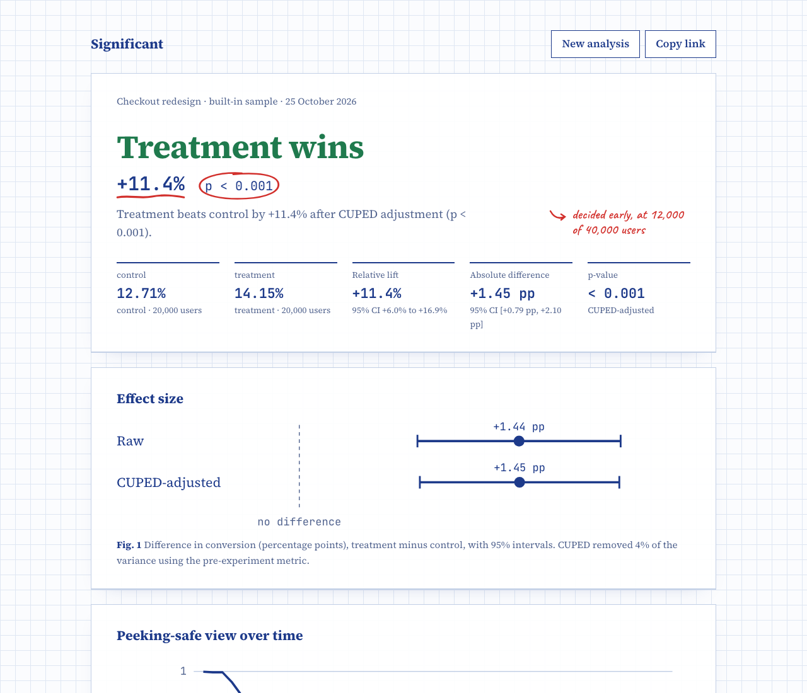

# Significant

An A/B test analyzer that gives a readout you can defend. Upload an experiment as a CSV, or try one of three samples with a planted answer. You get the effect with its uncertainty, after the checks a reviewer would ask for first. Every report gets a shareable link.

**Live demo:** coming soon



## What it checks, and why

| Check | Why it matters |
|---|---|
| **Significance with intervals.** A two-proportion z-test for conversion metrics and Welch's t-test for continuous ones. The relative lift gets a delta-method interval. | A lift is a range, not a point. The interval shows which effects are still plausible, so a null result reads as "inconclusive" rather than "no effect". |
| **CUPED** (Deng et al., 2013). The metric is adjusted with a pre-experiment covariate using one pooled θ. | It removes noise the experiment didn't cause. On the `pricing_null` sample it cuts variance by 45%, which gives the same answer with a much tighter interval. |
| **Sample ratio mismatch.** A chi-square test of the observed split against the designed one, flagged at p < 0.001. | A broken split means users were lost or duplicated unevenly, which can bias every other number. A flagged SRM overrides any "win". |
| **Always-valid sequential testing.** A normal-mixture mSPRT (Johari et al., 2017) with a confidence sequence, computed at up to 50 looks. | Peeking at a classic p-value inflates false positives. This p-value stays valid at every look, so a test can stop as soon as it is decided. By default τ is set from the final sample's variance, which makes the guarantee approximate; pass `tau` fixed before the test for the strict version. The `checkout_win` sample is decided at 12,000 of its 40,000 users. |
| **Power.** Sample size per arm for a two-sided test, and the minimum detectable effect for a given n. | Sizes the next test from this one's baseline. |

The verdict comes from the CUPED result when a `pre_metric` column exists, and from the raw test otherwise.

## How it is verified

The statistics are pure numpy functions. Each one is tested against a reference or a simulation:

- The z-test matches `statsmodels.proportions_ztest`. Welch's t-test, its degrees of freedom and its interval match `scipy.stats.ttest_ind(equal_var=False)`. SRM matches `scipy.stats.chisquare`. Continuous power matches `statsmodels.NormalIndPower`. CUPED's θ and adjusted means and the mSPRT p-value are checked against their closed forms.
- 2,000 simulated A/A tests give a false-positive rate in [3.5%, 6.5%] at α = 0.05.
- 2,000 simulations confirm that the absolute and delta-method intervals cover the true effect 93–97% of the time.
- 500 A/A streams, checked at every look, stop by mistake at most 7% of the time. The always-valid p-value never increases, and the confidence sequence only narrows.
- Each sample dataset reproduces its planted ground truth: a win, a null and a broken split.

There are 94 API tests with 97% coverage, plus web unit tests and a Playwright end-to-end test.

## CSV format

| Column | | Meaning |
|---|---|---|
| `user_id` | required | One row per user. Duplicates are rejected. |
| `variant` | required | Exactly two values. The control is `control`, `a` or `baseline`, else the first alphabetically, or set it explicitly. |
| `metric` | required | 0/1 for conversion, or any number. |
| `pre_metric` | optional | The same metric before the test. Enables CUPED. |
| `timestamp` | optional | ISO-8601 or epoch seconds. Enables sequential testing. |

Uploads can be up to 20 MB and 1,000,000 rows. A BOM, CRLF line endings, quoted fields and extra columns are all fine. Raw rows are never stored: only the computed report is saved, under a random 10-character link, and it is deleted after 90 days.

## API

All errors use `{"error": {"code": "...", "message": "..."}}`.

| Method and path | Behaviour |
|---|---|
| `POST /analyses` | Multipart `file`, plus the optional form fields `name`, `control`, `expected_split`, `alpha` and `tau`. Returns `201 {id, report}`. Errors: `400` with the ingest code, `413 too_large`, `422 bad_option`, `429 rate_limited`. |
| `POST /analyses/samples/{name}` | Analyses a built-in sample (`checkout_win`, `pricing_null`, `broken_split`). |
| `GET /analyses/{id}` | A stored report, or `404 not_found`. |
| `GET /samples`, `GET /samples/{name}.csv` | The sample list, and each sample as a downloadable CSV. |
| `POST /power` | `{baseline, mde, alpha?, power?, kind?, sd?}` returns `{n_per_arm, total}`. |
| `GET /healthz`, `GET /readyz` | Liveness, and readiness (which also checks Postgres). |

Analyses are limited to 20 per IP per hour. CORS allows only the dashboard origin.

## Architecture

```
api/   Python 3.13 · FastAPI · numpy/scipy/pandas · Postgres (psycopg 3)
  app/stats/      pure functions: tests, cuped, srm, sequential, power
  app/ingest.py   CSV → validated per-arm arrays
  app/analysis.py arrays → report + verdict
  app/store.py    reports as JSONB, purged after 90 days
  app/main.py     routes, error envelope, rate limit, CORS
web/   Next.js · React 19 · hand-drawn SVG figures; /r/[id] is server-rendered for link previews
```

## Run it locally

Requires Python 3.13 with uv, Node 24 and Docker.

```bash
docker compose up -d --wait                    # Postgres on :5436

cd api && cp .env.example .env && uv sync
set -a && . ./.env && set +a
uv run uvicorn --factory app.main:app_from_env --port 8300

cd ../web && cp .env.example .env.local
npm install && npm run dev                     # http://localhost:3300
```

Tests:

```bash
cd api && uv run pytest --cov=app             # needs the compose Postgres
cd ../web && npm test && npm run e2e
```
